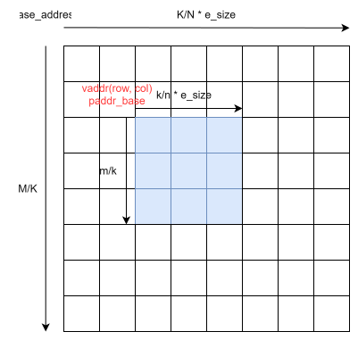

= XiangShan AI Programming Guide

== Non-Blocking Behavior of Matrix Operations

When Zmasync is implemented with AME, the matrix load, store, mma (matrix multiply-accumulate), and mzero instructions exhibit non-blocking behavior. Each instruction performs a single virtual-to-physical address translation at dispatch time (before instruction commit). Once the physical address is resolved, the instruction accesses memory using this physical address without performing further address translations during the asynchronous execution phase.

This address translation strategy has important implications:

1. **No Deadlock with Async Instructions**: Address translation completes before the instruction commits and before any asynchronous memory operations begin. This ensures that page table walks do not interfere with or block on the completion of asynchronous matrix operations.

2. **Physical Page Contiguity Requirement**: The accessed matrix region must occupy physically contiguous pages. Since address translation occurs only once at dispatch, the hardware assumes that subsequent accesses within the matrix can be computed using simple offset arithmetic from the initial physical base address.

== Address Calculation

Matrix load/store instructions access a tile-sized sub-region within a larger matrix. The tile dimensions are determined by `msettile{m|k|n}` CSRs. For example, loading matrix A accesses `mtilem` rows and `mtilek` columns.



**Software side** — compute the virtual base address of the tile from the large matrix:

```
# base_address: start of the large matrix in memory
# stride: row stride of the large matrix in bytes
# (R, C): row and column position of the tile's top-left element
vaddr = base_address + R * stride + C * e_size
```

Software passes `vaddr` and `stride` as operands to the load/store instruction. Each element within the tile is accessed at an offset from `vaddr` (taking matrix A as an example, with `m_i ∈ [0, mtilem)` and `k_i ∈ [0, mtilek)`):

```
offset(m_i, k_i) = m_i * stride + k_i * e_size
```

**Physical address during asynchronous execution** — the hardware performs a single virtual-to-physical address translation on `vaddr` at dispatch time, then computes physical addresses using offset arithmetic:

```
paddr_base = translate(vaddr)
paddr(m_i, k_i) = paddr_base + offset(m_i, k_i)
```

This offset-based physical address calculation is valid only when the entire tile region occupies physically contiguous memory, as stated in the physical page contiguity requirement above.
